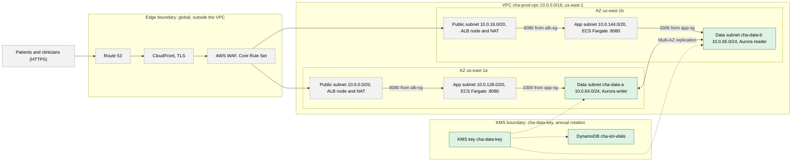

# AWS Healthcare Cloud Migration: CloudFusion Healthcare Analytics

[](https://github.com/ShariniN/aws-healthcare-cloud-migration/actions/workflows/iac-security.yml)

Architecture and proof of concept for moving a healthcare analytics company from a single on-premises data centre to AWS.
University module: Enterprise Cloud and Distributed Web Applications (2026).

**Starting point:** one data centre, ~220 VMware VMs, a monolith on SQL Server + MySQL, manual operations, no DR.
**Targets:** 99.99 % availability, 100,000+ concurrent users, ≥ 40 % lower operating cost, compliance with GDPR, India's DPDP Act 2023 and UAE health-data law.

Two platforms are in scope:
- **PMP (Patient Monitoring Platform):** wearables stream vitals to the cloud.
- **TPP (Telemedicine and Patient Portal):** booking, patient portal and video consultations.


## Architecture and threat model

Trust boundaries run from the internet, through the edge, into the VPC, and down to the KMS-encrypted data tier. Green boxes are managed by [`terraform/main.tf`](terraform/main.tf). Grey dashed boxes were built in the console and are not in code.



| Layer | Boundary it guards | Threat | Control | Evidence |
|---|---|---|---|---|
| Identity | People and workloads | Long-lived keys, over-broad access | IAM roles for workloads, MFA on every human login, named least-privilege policy | Report §5.1, Listing 1 |
| Edge | Internet to VPC | Web exploits, network-layer DDoS | WAF Core Rule Set on CloudFront, Shield Standard, TLS at CloudFront | Report §5.1, Appendix G |
| Network | Public, app and data tiers | Lateral movement, unauthorised database access | Security groups chained by reference (`alb-sg` to `app-sg` to `db-sg`), network ACL on data subnets | [`terraform/main.tf`](terraform/main.tf), report Appendix C |
| Encryption | Data at rest and in transit | Exposure from storage or the wire | Customer-managed KMS key with rotation, TLS to CloudFront, `require_secure_transport` on Aurora | [`terraform/main.tf`](terraform/main.tf), [`terraform_apply.png`](screenshots/terraform_apply.png) |
| Logging and governance | Whole account | Undetected change or tampering | CloudTrail with log-file validation, AWS Config, Security Hub, GuardDuty | [`security_hub.png`](screenshots/security_hub.png), report §5.1 |

The report describes these five controls. The Terraform checks for the network and data tier run in CI. Known gaps, such as VPC flow logs and the KMS key policy, are marked inline in `main.tf` with the production change that would close them.

## Design

| Layer | Services |
|---|---|
| Edge | Route 53, CloudFront, AWS WAF, Shield |
| Network | VPC across 2 AZs × 3 tiers (public / app / data), NAT per AZ, S3 + DynamoDB gateway endpoints, Site-to-Site VPN for branch hospitals |
| Compute | ECS on Fargate behind an Application Load Balancer |
| Data | Aurora MySQL (Multi-AZ), DynamoDB on-demand for IoT vitals, S3 with lifecycle tiering |
| Messaging | IoT Core → SQS (absorbs bursts) → SNS clinician alerts |
| Migration | AWS DMS (full load + CDC), weighted Route 53 cutover in waves (5 → 25 → 100 %) |
| Analytics | Glue + Athena |
| Security | IAM least privilege with MFA, KMS customer-managed keys, security groups chained by reference + NACLs, CloudTrail with log-file validation, AWS Config, GuardDuty, Security Hub, IAM Access Analyzer |
| Operations | CloudWatch dashboards and alarms, warm-standby DR |

Estimated core platform cost: **~USD 1,194 / month** (AWS Pricing Calculator).

## Proof of concept

Built in a sandbox account in `us-east-1`, then torn down after assessment to avoid charges. Evidence is in [`screenshots/`](screenshots/) and the full report in [`docs/`](docs/).

- Most resources were built in the AWS console.
- The network, security groups, KMS key, DB subnet group and DynamoDB table were also provisioned with **Terraform** (`plan` / `apply` / `destroy` run locally); see [`terraform/main.tf`](terraform/main.tf) and [`screenshots/terraform_apply.png`](screenshots/terraform_apply.png).
- DMS migrated a source MySQL schema into Aurora; a Glue job validated row counts; WAF blocked a test XSS request; GuardDuty flagged root credential use, which was fixed by moving to an MFA-protected IAM user.

## Contents

```
diagrams/      architecture, data-flow and hybrid-edge diagrams (PNG + draw.io source)
terraform/     IaC for the network and data-tier foundations
screenshots/   console and CLI evidence from the proof of concept
docs/          full report (PDF)
```
