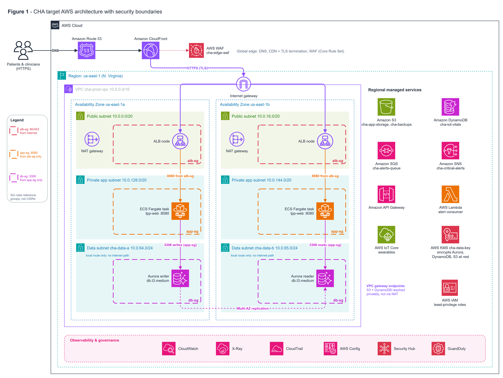

# AWS Healthcare Cloud Migration: CloudFusion Healthcare Analytics

Architecture and proof of concept for moving a healthcare analytics company from a single on-premises data centre to AWS.
University module: Enterprise Cloud and Distributed Web Applications (2026).

**Starting point:** one data centre, ~220 VMware VMs, a monolith on SQL Server + MySQL, manual operations, no DR.
**Targets:** 99.99 % availability, 100,000+ concurrent users, ≥ 40 % lower operating cost, compliance with GDPR, India's DPDP Act 2023 and UAE health-data law.

Two platforms are in scope:
- **PMP (Patient Monitoring Platform):** wearables stream vitals to the cloud.
- **TPP (Telemedicine and Patient Portal):** booking, patient portal and video consultations.



## Design

| Layer | Services |
|---|---|
| Edge | Route 53, CloudFront, AWS WAF, Shield |
| Network | VPC across 2 AZs × 3 tiers (public / app / data), NAT per AZ, S3 + DynamoDB gateway endpoints, Site-to-Site VPN for branch hospitals |
| Compute | ECS on Fargate behind an Application Load Balancer |
| Data | Aurora MySQL (Multi-AZ), DynamoDB on-demand for IoT vitals, S3 with lifecycle tiering |
| Messaging | IoT Core → SQS (absorbs bursts) → SNS clinician alerts |
| Migration | AWS DMS (full load + CDC), weighted Route 53 cutover in waves (5 → 25 → 100 %) |
| Analytics | Glue + Athena |
| Security | IAM least privilege with MFA, KMS customer-managed keys, security groups chained by reference + NACLs, CloudTrail with log-file validation, AWS Config, GuardDuty, Security Hub, IAM Access Analyzer |
| Operations | CloudWatch dashboards and alarms, warm-standby DR |

Estimated core platform cost: **~USD 1,194 / month** (AWS Pricing Calculator).

## Proof of concept

Built in a sandbox account in `us-east-1`, then torn down after assessment to avoid charges. Evidence is in [`screenshots/`](screenshots/) and the full report in [`docs/`](docs/).

- Most resources were built in the AWS console.
- The network, security groups, KMS key, DB subnet group and DynamoDB table were also provisioned with **Terraform** (`plan` / `apply` / `destroy` run locally); see [`terraform/main.tf`](terraform/main.tf) and [`screenshots/terraform_apply.png`](screenshots/terraform_apply.png).
- DMS migrated a source MySQL schema into Aurora; a Glue job validated row counts; WAF blocked a test XSS request; GuardDuty flagged root credential use, which was fixed by moving to an MFA-protected IAM user.

## Contents

```
diagrams/      architecture, data-flow and hybrid-edge diagrams (PNG + draw.io source)
terraform/     IaC for the network and data-tier foundations
screenshots/   console and CLI evidence from the proof of concept
docs/          full report (PDF)
```
